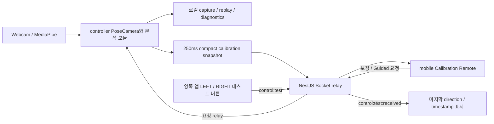
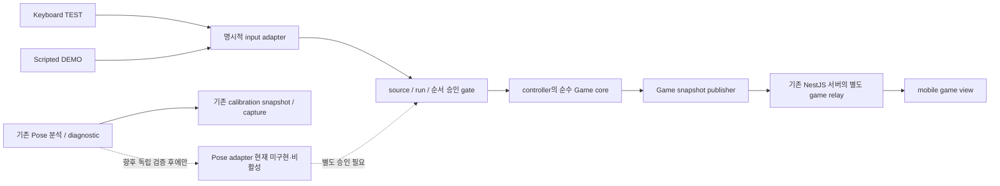

# STEP 4T — Game Input Strategy and MVP Architecture Decision

작성일: 2026-10-13 · 검토 기준 HEAD: `9d1c17ef92ce5652d5648eee2d132e84ae33c87d`

**결정: 다음 구현은 B — 입력 소스와 게임 로직을 분리한 Game MVP로 진행한다.** 자동 니킥 detector의 게임 연결은 보류하고 기존 분석·capture·replay 기능은 보존한다. C — 센싱 재설계는 독립 검증 계획부터 준비하며, A — detector 개선은 그 계획과 실제 동작 ground truth가 준비된 뒤 재개한다. **STEP4S의 `NO_SAFE_CANDIDATE`는 그대로 유지한다.** 시험한 정책에 안전한 후보가 없다는 뜻이며, 자동 니킥 인식이 일반적으로 불가능하다는 뜻은 아니다.

이번 산출물은 설계 결정이다. 아래 새 타입, 파일, 이벤트, 화면, milestone은 **구현 제안**이며 현재 제공되는 기능으로 세지 않는다. 추천의 개발 효율·사용성 효과는 `HYPOTHESIS`, 실제 Game MVP 동작은 `NOT_EVALUATED`다.

## 1. 증거의 수준과 검토 범위

| 표기 | 이 문서에서의 의미 |
| --- | --- |
| VERIFIED | 현재 source에서 확인한 기능·경계 또는 기존 보고서에 기록된 재현/무결성 검증. 범위를 함께 표기하며 제품 정확도 인증을 뜻하지 않는다. |
| OBSERVED | 특정 capture, counterfactual 또는 synthetic 입력에서 관측된 결과. 다른 사람·환경으로 일반화하지 않는다. |
| HYPOTHESIS | 다음 의사결정을 위한 가설·기대 효과. 근거와 확인 방법은 있지만 아직 입증하지 않았다. |
| NOT_EVALUATED | 해당 제품 기능·인과관계·성능을 평가하지 않았거나 평가할 입력이 부족하다. |

이번 STEP은 문서와 실제 코드를 읽는 검토만 수행한다. 과거 테스트 PASS와 분석 결과를 인용하며, 새 촬영·모델 추론·shadow replay·성능 실험을 실행하지 않는다. 기존 private raw를 새 산출물로 복사하지 않는다.

검토한 주요 근거:

- [4P capture hardening 및 test worker policy](step-4p-capture-hardening.md), [README의 4P.2 mobile readiness](../README.md#step-4p2--mobile-estimator-neutral-readiness).
- [4Q 단일 V2 holdout](step-4q-holdout-analysis.md), [4R divergence attribution](step-4r-live-video-divergence.md), [4S recovery feasibility](step-4s-recovery-shadow-feasibility.md) 및 각 집계 JSON.
- [V2 media integrity](../apps/controller-web/src/replay/mediaArtifact.ts), [estimator reference readiness](../apps/controller-web/src/capture/estimatorNeutralReadiness.ts), [사전등록 protocol](../apps/controller-web/src/capture/estimatorValidationProtocol.ts).
- [4Q 분석](../apps/controller-web/src/holdout/v2HoldoutAnalysis.ts), [4R 분석](../apps/controller-web/src/holdout/liveDivergenceAnalysis.ts), [4S 평가](../apps/controller-web/src/holdout/recoveryPolicyAnalysis.ts), [shadow factory](../apps/controller-web/src/holdout/recoveryShadowFactory.ts), [synthetic controls](../apps/controller-web/src/holdout/recoverySynthetic.ts).
- [controller App](../apps/controller-web/src/App.tsx), [PoseCamera 연결부](../apps/controller-web/src/components/PoseCamera.tsx), [실제 V3 detector](../apps/controller-web/src/pose/kick/kneeKickDetectorV3.ts), [live 분석 lifecycle](../apps/controller-web/src/pose/kick/kneeKickAnalysis.ts).
- [mobile App](../apps/mobile/src/App.tsx), [CalibrationPanel](../apps/mobile/src/calibration/CalibrationPanel.tsx), [mobile remote hook](../apps/mobile/src/calibration/useCalibrationRemote.ts), [controller remote hook](../apps/controller-web/src/remote/useCalibrationRemote.ts), [command/snapshot adapter](../apps/controller-web/src/remote/calibrationRemoteController.ts).
- [NestJS relay](../apps/server/src/control.gateway.ts), [공통 event map](../packages/protocol/src/index.ts), [calibration wire types](../packages/protocol/src/calibration.ts), [kick debug types](../packages/protocol/src/kneeKick.ts), [실제 Socket relay 테스트](../apps/controller-web/src/remote/calibrationRelay.test.ts).

### 1.1 지금까지 확인한 사실

| 수준 | 사실과 범위 | 설계에 주는 의미 |
| --- | --- | --- |
| VERIFIED | 4P는 최종 WebM Blob의 SHA-256/byteLength와 전체 decoded PTS/dimension을 저장·검증한다. V2는 동일 bytes의 filename 변경을 허용하고, 다른 bytes는 거부한다. | 분석 파일의 동일성과 인식 정확도를 별개로 관리할 기반이 있다. |
| VERIFIED | Production Neutral과 별도로 3초/60 usable frames/8 joints reference를 수집한다. Capture 중 Guided 시작을 gate하며, 시작 후 22초는 pose loss로 멈추지 않는다. | Capture READY는 실험 준비 상태다. 게임 입력 승인이나 동작 성공이 아니다. |
| VERIFIED | 4Q 보고서는 세 estimator의 동일 1,988 PTS, WebM 33,530,994 bytes/SHA 일치, 동일 3초 reference를 확인했다. | 이 비교의 media/PTS integrity는 확보됐지만 LIVE와 재추론의 동일 landmark는 보장하지 않는다. |
| OBSERVED | 단일 V2의 Guided 채점은 LIVE LEFT/RIGHT/false = 1/1/0, FULL_VIDEO Y V3 = 0/1/1. FULL_IMAGE = 0/0/0이지만 kick coverage 부족, HEAVY는 Neutral knee usable 0/0. | Zero false만으로 성공하거나 IMAGE/HEAVY로 교체할 근거가 없다. |
| VERIFIED | 4R의 원본 LIVE replay는 저장 baseline·actual clockSamples·markers로 이벤트 시각, stage summary, 최종 ARMED까지 parity PASS다. | 관측된 LIVE/VIDEO 차이를 원본 replay 버그로 귀속할 근거는 없었다. |
| OBSERVED | 4R에서 production 1초 baseline A와 LIVE/VIDEO 각각의 3초 baseline B/C를 교체해도 이벤트 결과는 같았다. 같은 A에서 입력 스트림을 바꾸면 차이가 났고, VIDEO matched subset에서는 Neutral false가 사라졌다. | 귀속은 `MIXED`: input stream + sampling 민감도다. 둘은 겹치며 독립적인 근본 원인 두 개가 증명된 것은 아니다. |
| OBSERVED | 4S 결합 정책은 이 capture에서 LIVE 1/1/0을 유지하고 VIDEO를 1/1/0으로 만들었으나, sustained fake high-Y false와 연속 킥 누락 synthetic controls를 통과하지 못했다. | `NO_SAFE_CANDIDATE`를 유지한다. Production 전환 사유가 아니다. |
| NOT_EVALUATED | Guided label과 독립적으로 주석한 실제 신체 동작 ground truth, 다인/다환경 인식 정확도, 운동 입력을 사용한 게임 경험. | 기존 1/1은 일반화된 recall 추정치가 아니며 게임 품질 보증도 아니다. |

4Q/4R/4S의 L/R/false는 저장된 **Guided 지시 구간**에 대한 채점이다. 사람이 지시와 정확히 동시에 동작했다는 독립적 확인은 아니다. Guided 이후 `trialId: null` 이벤트는 별도 diagnostic이며 성공/오탐 수에 임의로 넣지 않는다. 기존 V2는 4R/4S 탐색에 이미 사용됐으므로 향후 새 정책의 독립 holdout으로 재사용할 수 없다.

## 2. 제품 요구사항과 현재 아키텍처

### 2.1 유지할 제품 목표

다음은 사용자 요구사항이며 성능 관측과 구분한다.

- 사용자는 플랭크 자세로 운동한다. 노트북 웹캠은 운동 입력을 관측한다.
- 스마트폰/태블릿은 얼굴 가까이에 놓는 게임 상태·안내 화면이다. 운동 중 지속적인 폰 터치를 요구하지 않는다.
- 장기적으로 신체 기준 좌우 움직임을 게임 입력으로 연결한다. Preview Mirror는 신체 좌우나 게임 action mapping을 바꾸지 않는다.
- 운동 전 준비/시작, 운동 후 종료/재시도 조작과 운동 중 반복 입력을 구분한다. 보조자가 키보드를 누르는 테스트를 완성된 1인 운동 UX로 설명하지 않는다.

### 2.2 현재 제공되는 것 — VERIFIED, source 기준

| 영역 | 실제 책임 | 아직 없는 것 |
| --- | --- | --- |
| controller-web | React/Vite, webcam/MediaPipe, raw/feature/classifier/kick debug, calibration, guided validation, private capture/replay/analysis. `PoseCamera`가 inference 결과를 기존 모듈에 전달한다. | 게임 규칙, 게임 점수, 게임 입력 adapter/승인 gate, keyboard game input |
| mobile | React/Vite의 `Mobile Game` 문구 아래 Calibration Remote. Neutral/action/readiness, Guided stage/countdown, detector counts와 요약, 테스트 버튼. | 플레이 가능한 게임 scene, 게임 점수/state machine. 표시된 kick counts는 detector 진단값이다. |
| server | NestJS HTTP/Socket.IO, `0.0.0.0:3000`, `/health`. dev origin 5173/5174 허용. 요청과 compact state를 전체 client에 relay. | authoritative game state, 점수 계산, 메시지 소유권/인증/Room/DB, 게임별 routing |
| protocol | `control:test`, calibration/validation/motion/kick-test 요청·snapshot 타입. | GameInput/GameState schema, scoring 계약, 운동 입력 승인 계약 |
| STEP1 test input | 양쪽 앱 LEFT/RIGHT 버튼이 `{ direction, timestamp: Date.now() }`를 emit. 서버 broadcast를 받아 마지막 값만 표시한다. | 중복 방지 ID, 게임 run 식별, 자동 운동 검증, 게임에서 소비되는 input |

**현재 `Mobile Game`은 제품 이름/표시 문구이며, 구현된 게임을 뜻하지 않는다.** Dependency 목록에 Phaser/Capacitor는 없다. 새 게임 엔진을 도입하지 않아도 React로 작은 상태·점수 MVP를 검증할 수 있다는 것은 설계 제안이다.

현재 데이터 흐름:



재사용할 lifecycle과 경계:

- Controller가 실제 준비 상태를 재검사하고 command ID를 중복 방지한다. Mobile snapshot은 명령 허가의 최종 authority가 아니다.
- Snapshot은 250ms 주기다. Mobile은 로컬 수신 시각으로 1,500ms freshness를 확인하며 disconnect/stale 시 상태를 비운다. 이 수치는 현재 보정 UI용이고 향후 게임 지연 허용 기준으로 자동 승격하지 않는다.
- Socket listener/interval 해제, camera stop/unmount 시 기존 분석 reset, Mirror 표시 분리, 로컬 다운로드를 유지한다.
- Protocol의 `RemoteKneeKickState`는 명시적으로 **debug/test snapshot**이다. `lastEvent`, `currentEvent`, `counts`, `stableAction`을 새 게임 이벤트처럼 polling하면 재전송·누락·중복·reset 혼동을 만들 수 있다. 직접 scoring에 연결하지 않는다.
- V3는 live 분석의 primary이나 `experimental`이다. `ready`는 baseline 존재, `validNow`는 fresh frame과 적어도 한쪽 usable knee를 뜻한다. 양쪽 동작의 정확도 승인과 다르다.

### 2.3 실제 게임 입력으로 아직 검증되지 않은 것

모두 `NOT_EVALUATED`: detector → game end-to-end 정확도, Twist classifier의 실게임 대안 적합성, 네트워크 지연을 포함한 반응성, 장시간 연속 운동/재무장 availability, 폰 가독성과 안내 이해도, 모델/배치 변경의 우월성. 기존 LAN relay 테스트 PASS는 메시지 전달 검증이다. 실제 운동 인식 성공이나 폰을 보며 끝까지 플레이 가능한 UX를 입증하지 않는다.

## 3. 남은 인식 문제

| 수준 | 문제 | 해결됐다고 볼 수 없는 이유 |
| --- | --- | --- |
| OBSERVED | FULL_VIDEO LEFT: loss 뒤 high-Y가 있어도 Neutral clear 부족으로 entry gate에 막혔다. | 단순 threshold crossing만으로 usable action이 되지 않는다. |
| OBSERVED | 마지막 Neutral: unilateral clear 후 다시 high-Y가 50ms dwell을 충족해 false가 났다. | `POST_REACQUISITION` tag는 과거 재획득 이후라는 뜻이며 직전 tracking jump 원인을 증명하지 않는다. |
| OBSERVED | S1은 LEFT를 살리지만 sustained fake high-Y도 fresh evidence로 확정한다. | Old epoch를 폐기하는 것은 필요하지만 false 차단의 충분조건이 아니다. |
| OBSERVED | S2는 false를 막지만 반대 다리 clear가 없으면 다음 실제 synthetic kick도 막는다. LIVE 재무장은 약 1.133초 늦었다. | False만 줄이는 정책은 missed input/availability 비용을 숨길 수 있다. 이 LIVE 구간에는 추가 정답 킥이 없어 실측 recall 회귀로 세지는 않았다. |
| OBSERVED | FULL_IMAGE kick stage pose coverage는 LEFT 77.8%, RIGHT 42.2%. HEAVY Neutral pose는 90/90이나 knee visibility가 LEFT .0117–.0441, RIGHT .0039–.0133이었다. | Pose 존재와 양쪽 knee usability는 다르다. HEAVY detector 성능은 `NOT_EVALUATED`다. |
| HYPOTHESIS | Foot-side에서의 투영/가림/원근이 knee 관측에 영향을 줄 수 있다. | 현재 비교는 카메라 배치를 통제한 실험이 아니다. 카메라 원인이나 다른 배치의 우위는 미확정이다. |

고정된 CONTROL 값은 enter .40/50ms, clear .25/100ms, tracking loss 33ms, stale 400ms다. 이번 결정은 이 값을 바꾸거나 S1/S2를 live로 옮기는 근거가 아니다. Twist를 “이미 되는 입력”으로 대체하는 것도 별도 검증 없이는 같은 오류다.

## 4. 개발 경로 비교

아래 비용/위험의 상대 평가는 일정·성능 benchmark가 아닌 설계 판단(`HYPOTHESIS`)이다.

| 기준 | A. 자동 니킥 개선 계속 | B. 입력 분리 Game MVP 우선 | C. 센싱/카메라 배치 재설계 |
| --- | --- | --- | --- |
| 현재 증거 | V3/replay/diagnostics와 재현 가능한 miss/false가 있다. 4S 안전 후보는 없다. | LAN relay, 폰 remote UI, typed protocol, 결정적 분석 모듈을 테스트하는 기반이 있다. Game core는 아직 없다. | Foot-side 단일 V2에서 양쪽 관절 usability/geometry 문제가 관측됐다. 원인 검증은 없다. |
| 미검증 가정 | 현재 landmark signal에서 false와 true kick을 분리할 근거가 더 존재하는가? | 입력과 무관한 상태·점수·안내를 먼저 만들면 통합 위험과 연구 의존성을 줄일 수 있는가? | 사선/측면/높이 변경 또는 추가 센서가 양측 관측을 개선하는가? |
| 추가 비용 | 독립 ground truth, 새로운 development/holdout, loss/연속 동작 재현, 반복 분석. | Pure core, keyboard/test adapter, 별도 game snapshot, 모바일 표시와 회귀 테스트. 새 운동 데이터는 초기 단계에 불필요. | 배치별 동일 과제·양측 가시성 측정, 설치/공간 평가. 다중 카메라는 동기화·장비, 착용 센서는 부착/보정/운영 부담도 발생. |
| 오탐·미탐 위험 | 둘을 동시에 줄일 보장이 없다. 연구 중 게임 event로 보내면 위험이 직접 전파된다. | TEST 입력으로만 game을 검증하면 인식 위험을 scoring에서 격리할 수 있다. 실제 운동 UX는 미완성으로 남는다. | 새로운 가림/방향 혼동/설치 실패 가능. 센서 변경만으로 정확도가 검증되지는 않는다. |
| 게임 개발 지연 | 인식 성공을 선행 조건으로 두면 높음. 완료 시점 불확실. | 가장 작은 end-to-end game slice부터 진행 가능. 과도한 engine/framework 도입을 피해야 함. | 전체 제품 경로로 먼저 택하면 조사·장비 비용 때문에 지연될 수 있음. |
| 다음 단계 결정 | 게임 출시의 즉시 선행 작업으로 삼지 않음. | **주 경로로 선택.** Detector와 별도로 증명 가능한 산출물부터 개발. | 검증 계획을 보조 경로로 준비. 배치/센서 변경 실행은 별도 단계로 한정. |

C의 baseline은 기존 발 쪽→머리 방향, 책상 높이, 전신 frame이다. 이는 비교 시작점이지 최적 배치나 확정 제품 요구사항이 아니다. 대안은 방 안에 실제 설치 가능한 공간, 노트북 유지 여부, 폰의 얼굴 쪽 배치, 양쪽 관절 가시성, 추가 비용을 함께 평가한다. 측면은 한쪽 무릎 가림을 늘릴 수도 있으므로 임의의 최적 각도나 성능 향상을 제시하지 않는다.

## 5. 추천 전략과 입력 경계

### 5.1 니킥을 보류해도 가능한 개발

**가능하다 — 구조적 개발 가능성에 대한 설계 판단이다.** Start/reset, 제한된 라운드, 좌우 action 처리, 점수·중복 방지, 결과 화면, 모바일 상태 동기화는 입력을 명시적으로 주입해 구현할 수 있다. 다만 이는 **TEST INPUT Game MVP**이며 자동 운동 게임 완료가 아니다.

첫 규칙은 제품 확정안이 아닌 최소 검증용으로 제안한다: 고정된 좌우 target 목록, target당 정답 action 한 번에 1점/다음 target, 오답은 점수 증가 없이 feedback, 마지막 target 뒤 COMPLETED. 콤보·난이도·물리·실시간 타격 window는 뒤로 미룬다. 게임 target의 LEFT/RIGHT는 action 계약이고, 나중에 신체 LEFT/RIGHT를 어떤 action에 매핑할지는 detector 외부 adapter에서 명시한다. 테스트 점수는 운동 횟수·정확도로 표기하지 않는다.

### 5.2 제안 아키텍처 — 이번 STEP에서는 구현하지 않음



- **Controller:** 초기 단일 사용자 LAN MVP의 유일한 game state/점수 authority. Game core는 React, MediaPipe, Socket, calibration, stage label을 import하지 않는 결정적 reducer다. Clock이 필요하면 caller가 같은 clock-domain의 값을 전달한다. Controller 새로고침은 해당 run 종료로 처리하고 복구 가능한 영구 저장을 주장하지 않는다.
- **Server:** 기존 서버·port·socket 연결을 재사용하되 game event handler를 별도로 추가하는 계획이다. 초기에는 검증된 game wire payload relay만 맡고 점수를 다시 계산하지 않는다. 기존 calibration/control:test handler를 바꾸거나 game action으로 해석하지 않는다.
- **Mobile:** 점수/state snapshot을 표시하며 점수 계산 authority가 아니다. 시작/중단/reset은 운동 전후 operator command, 반복 action 버튼은 debug에만 둔다. 이 단계에서 실제 게임 입력은 controller keyboard 또는 명시적 script다.
- **Pose:** 현재처럼 카메라·분석·readiness·capture 전용. Game core는 이 흐름 없이도 테스트 가능해야 한다. `PoseCamera.tsx`에 게임 규칙을 추가하거나 4S Node용 shadow factory를 앱에 import하지 않는다.

장기적으로 다중 사용자/신뢰 경계가 필요하면 server authority와 pairing/Room을 별도 결정한다. 지금은 single-controller 환경으로 범위를 제한한다. 현재 broadcast/CORS는 기기 인증이나 사용자 격리가 아니다.

### 5.3 최소 입력 계약 제안

아래는 문서상의 interface이며 새 protocol을 추가하지 않았다. U에서는 controller 내부에 두고, V에서 **실제로 wire에 필요한 DTO만** `packages/protocol`로 옮긴다. 새 공통 engine package나 plugin registry는 만들지 않는다.

```ts
type GameAction = 'LEFT_ACTION' | 'RIGHT_ACTION';
type InputProvenance =
  | { kind: 'TEST'; method: 'KEYBOARD' | 'SCRIPT' }
  | { kind: 'POSE'; detectorVersion: string; validationRecordId: string;
      calibrationEpoch: string }; // 미래 확장 제안. U~W에서 생성/허용하지 않음

interface GameInput {
  runId: string;
  sourceInstanceId: string;
  sequence: number;
  occurredAtMs: number; // controller monotonic clock, 같은 instance에서만 비교
  action: GameAction;
  provenance: InputProvenance;
}
```

`runId`는 초기화마다 달라지는 게임 실행 식별자이며 기존 Guided `trialId`나 captureId가 아니다. Source와 mode는 run 시작 때 고정한다. 입력 모드를 바꾸려면 새 run과 새 점수를 시작한다. Detector의 reset 가능한 숫자 event ID를 전역 game ID로 쓰지 않는다.

Adapter는 좌우 action으로 정규화하고, admission gate는 source/실행 권한·schema·중복·순서를 검사하며, core는 **승인된 action의 게임 효과만** 계산한다. 같은 `(runId, sourceInstanceId, sequence)`는 최대 한 번 적용한다. Out-of-order·이전 run·비정상 timestamp는 거부하고 reject reason을 diagnostic에 남긴다. 기본 key repeat, input/textarea focus, blur/unmount/reconnect 뒤 남은 입력을 명시적으로 처리한다. Game target/예상 정답은 adapter나 detector의 evidence가 아니다.

### 5.4 테스트와 운동 입력을 혼동하지 않는 UX

- TEST run의 controller/mobile/결과 화면에 항상 **TEST INPUT — KEYBOARD** 또는 **DEMO — SCRIPTED INPUT**을 표시한다. Source는 최종 결과에도 남긴다. 이를 `LIVE exercise`, 자동 인식 성공, 실제 니킥 횟수로 표시하지 않는다.
- Operator keyboard는 개발용이다. 혼자 폰을 바라보는 화면 점검은 script로 자동 진행할 수 있지만 화면·흐름 점검일 뿐 운동 인식 검증은 아니다. 향후 scripted adapter는 사전에 고정한 입력 목록을 사용하고 game target을 읽어 자동 정답을 생성하지 않는다.
- 기존 폰 LEFT/RIGHT는 Socket test로 남긴다. `control:test:received`를 은밀히 game core에 연결하지 않는다. 추후 별도 수동 game input이 필요하면 명시적인 TEST adapter와 별도 승인을 추가한다.
- 기존 `CalibrationPanel`/`EstimatorNeutralPanel`/`KneeKickPanel`은 분석 화면으로 재사용하고, 게임 기본 화면에는 필요한 안내·점수·연결 상태만 보인다. 보정 READY와 game READY, detector count와 game score를 별도 표시한다.

### 5.5 잘못된 자동 이벤트의 전달 방지

**당장 가능한 가장 명확한 보장은 Pose → Game 경로를 연결하지 않는 것이다.** U~W는 TEST allow-list만 허용한다. `ready`, `validNow`, `confidence`, `lastEvent` 또는 wire payload의 `source: POSE` 문자열만으로 운동 입력을 승인하지 않는다.

향후 Pose adapter는 아래 조건이 **모두** 준비된 뒤 별도 구현한다. 이것들은 필요조건이며 인식 오탐 0의 증명은 아니다.

| 조건 | 제안 책임과 테스트 |
| --- | --- |
| 독립 검증 및 explicit opt-in | 검증된 detector/config/version 기록과 허용 환경을 pin. Shadow/legacy/diagnostic은 기본 거부. 검증 결과가 없으면 TEST mode 유지. |
| 현재 frame 및 calibration epoch | 원본 event 발생 시점의 해당 side usable/fresh·baseline freeze·동일 epoch 확인. 오래된 250ms UI snapshot이나 마지막 event 재표시를 사용하지 않음. STOP/reset/recalibration에서 pending 입력 폐기. |
| Event identity와 run scope | Run/source/sequence로 dedupe. 같은 event를 controller local과 Socket echo 양쪽에서 적용하지 않음. 이전 run·재연결 backlog는 새 입력으로 재생하지 않음. |
| Causality와 시간 | Controller 기준 단조 시간과 명시적 순서 사용. Mobile `Date.now()`와 controller `performance.now()`를 빼서 freshness/latency를 계산하지 않음. Deadline은 게임 요구·측정 후 별도 고정. |
| Source의 실제 등록 | Adapter 생성·권한은 authority가 소유. Client가 적어 보낸 source/version 문자열만 신뢰하지 않음. 알 수 없는 source와 malformed event 거부. |
| 실패 시 동작 | Tracking loss면 해당 입력 없음/상태 안내. 임의 킥, 0 좌표, 보간, fallback TEST 입력을 만들어 점수 증가시키지 않음. 게임 시간 진행과 입력 유효성을 분리. |

현재 detector의 비차단 semantics는 유지한다. Tracking loss마다 게임/Guided 시간을 멈추거나 양쪽 관측 복구까지 사용자가 반드시 기다리게 하는 정책을 여기서 추가하지 않는다. 별도의 사용자 Pause/Stop은 game command다. 연결이 끊기면 폰은 점수를 추정하거나 밀린 동작을 생성하지 않고 disconnected/stale을 표시한다.

### 5.6 모바일 재사용과 전송 계약

기존 socket 한 개와 mount/unmount cleanup, typed event map, command requestId, reconnect sync 및 수신 시각 기반 stale 처리 패턴을 재사용한다. 보정 hook에 game stage/점수 계산을 섞지 않고 `useGameRemote`를 별도 경계로 둔다. State 전송은 **전체 compact snapshot + 증가하는 revision**으로 시작해 delta 병합 엔진을 만들지 않는다.

V에서 제안하는 별도 이벤트 이름은 `game:state:publish`/`game:state`, `game:sync:request`, `game:command`이며 최종 DTO/relay 요청 이름은 구현 시 테스트와 함께 고정한다. Snapshot에는 controller instance, runId, revision, phase, target, TEST provenance, score, 결과가 들어간다. Raw pose/baseline/영상은 들어가지 않는다. Snapshot 수신이 점수 증가를 유발해서는 안 된다.

초기 모바일은 운동 전에 명시적으로 선택한 하나의 controller instance/run만 표시한다. 다른 instance 또는 이전 revision은 무시하고 충돌 시 연결 선택 상태로 돌아간다. 이는 accidental cross-talk 방지이며 인증을 대체하지 않는다. 재연결은 sync 응답으로 현재 snapshot을 받고, offline command/event queue를 재생하지 않는다. Existing calibration 250ms/1,500ms semantics를 수정하지 않으며 게임 publish/freshness 기준은 V에서 명시적으로 정하고 테스트한다.

## 6. 다음 구현 milestone

아래 순서와 파일은 계획이다. 새 파일은 모두 **예정**이며 이번 STEP에서 만들지 않는다. U→V→W는 인식 정확도와 독립적으로 완료할 수 있다. X는 연구 재개 전 필수 설계 관문이며, 실제 새 데이터 수집/추론/검출기 구현은 X 완료 후 별도 범위로 진행한다.

### STEP 4U — Local Game Core + Keyboard TEST

- **목적:** 카메라와 Socket 없이 좌우 입력, 상태 전이, 점수 처리를 검증한다.
- **예정 파일/책임:** `apps/controller-web/src/game/gameTypes.ts`(내부 계약), `gameReducer.ts`(순수 상태 전이), `useKeyboardGameInput.ts`(키 입력 lifecycle), `components/GameTestPanel.tsx`(명시적 TEST UI), `App.tsx`(독립 panel 조립). 해당 `game/*.test.ts(x)`에 테스트를 둔다. 기존 `ControlDirection`이 맞는 곳에는 재사용한다.
- **최소 범위:** IDLE/RUNNING/COMPLETED, 고정 좌우 target, 정답 1점·오답 feedback, Start/reset, 중복/순서 gate, TEST source 기록. 두 키로 한 번씩 action. Pose adapter·Socket game event·Phaser 없음.
- **테스트:** 고정 event list의 결과 결정성, double dispatch/key repeat, invalid/old run/out-of-order, reset, StrictMode/unmount, text input focus/blur, Pose/unknown source 거부. 카메라를 켜지 않은 상태에서도 완료.
- **완료 조건:** 같은 입력에 같은 score/history, 중복 0회 가산, source 표기 누락 없음, Pose 모듈 없이 core 테스트 PASS. 기존 controller 전체 test/typecheck/build PASS.
- **회귀 위험:** App keyboard listener가 기존 보정 버튼/폼을 가로채는 문제, Game reset이 Pose reset으로 번지는 문제. 독립 lifecycle과 기존 UI 테스트로 확인한다.
- **이력서 근거:** 결정적 reducer, 입력 계약/중복 방지, React lifecycle 검증. 완료한 코드·테스트를 근거로 기술하고 자동 운동 인식 성공은 주장하지 않는다.

### STEP 4V — LAN Game Snapshot + Mobile View

- **목적:** U에서 만든 authoritative state를 폰에 표시하고 운동 전후 command를 전달한다.
- **예정 파일/책임:** `packages/protocol/src/game.ts` 및 `index.ts`(wire DTO만), `apps/server/src/game.gateway.ts`와 `app.module.ts`(기존 서버의 game relay), controller `game/useGamePublisher.ts`(snapshot/sync/command), mobile `game/useGameRemote.ts`, `game/GamePanel.tsx`, `App.tsx`/`App.css`(게임/분석 화면 구분). 테스트는 기존 controller runner의 `remote/gameRelay.test.ts`, `remote/mobileGame.test.tsx` 등으로 기존 NestJS/Socket 통합 패턴 재사용.
- **최소 범위:** 한 controller/한 선택된 run, full snapshot revision, Start/reset/Stop operator command, reconnect sync, TEST provenance/점수/target/연결 상태. In-memory이며 DB/Room/인증/remote action transport 없음. TypeScript 타입 외 런타임 payload 검사도 정의한다.
- **테스트:** 실제 NestJS+두 Socket client, duplicate request·echo, wrong instance/run, old revision, malformed payload, disconnect/reconnect, unmount. 기존 calibration/control:test relay assertion 그대로 유지. 실기기 LAN 점검은 keyboard TEST로만 하며 새 운동/촬영을 요구하지 않는다.
- **완료 조건:** controller와 mobile의 run/revision/score 일치, 재접속 후 점수 중복 없음, stale 화면에서 현재 결과인 척 표시하지 않음. 기존 250ms calibration flow와 test 버튼 유지. 전체 test/typecheck/build PASS.
- **회귀 위험:** server listener 충돌, broadcast 오염, 타입 변경으로 기존 보정 화면 손상. 별도 event 이름과 기존 tests로 차단한다.
- **이력서 근거:** typed Socket 계약, 단일 authority/revision 동기화, 실제 relay 통합 테스트. LAN 테스트와 실제 운동 인식을 별도 성과로 기록한다.

### STEP 4W — Hands-free Display Demo + Failure UX

- **목적:** 운동 중 화면 조작 없이 안내·점수·종료를 볼 수 있는 display 흐름을 점검한다. 아직 운동 입력 검증은 아니다.
- **예정 파일/책임:** controller `game/scriptedGameInput.ts`(사전 정의한 TEST 입력 목록), `GameTestPanel.tsx`(run 시작 전 source 선택); mobile `game/GamePanel.tsx`/`App.css`(큰 안내·상태·결과), 필요 시 `game/useGameVoiceGuide.ts`(stage 진입 1회 optional speech). 음성 취소/실패 격리 방식은 기존 `recorder/usePoseRecorder.ts` 및 Action UI 패턴을 재사용하고 기존 보정 음성 engine을 개조하지 않는다.
- **최소 범위:** Start 한 번 뒤 DEMO script→완료, Stop/reset, 큰 현재 action/점수/TEST 표기. 음성은 한 기기에서만 활성화하고 실패해도 진행. 예상 target을 읽어 input을 자동 생성하지 않음. 새 game 종류/콤보/물리 없음.
- **테스트:** fake clock script 재현, 중간 reset/stop/unmount 후 입력 0, speech unsupported/예외/중복 발화, network loss와 background/foreground 복귀, reconnect 시 과거 action 재생 없음. 폰을 얼굴 쪽에 두는 화면 확인은 향후 선택적 UX 확인이며 이번 STEP에서 운동을 요청하지 않는다.
- **완료 조건:** 한 번의 시작으로 반복 터치 없이 TEST demo 종료, TEST임이 모든 화면/결과에서 명확함, 연결 이상/중단이 정상 점수처럼 보이지 않음. 전체 test/typecheck/build PASS. 실제 장시간 플랭크의 가독성·피로는 별도 `NOT_EVALUATED`로 남길 수 있다.
- **회귀 위험:** 두 기기 음성 충돌, 타이머 backlog, calibration 화면/가이드 퇴행. 기존 보정 로직과 독립하고 실기기 화면 점검 결과를 따로 기록한다.
- **이력서 근거:** 입력 소스 교체, 취소 가능한 timer/음성 lifecycle, 모바일 상태 동기화/오류 UX. Script를 신체 동작 인식 데모로 소개하지 않는다.

### STEP 4X — Independent Recognition Validation Preregistration

- **목적:** 새 detector 정책을 설계하기 전에 ground truth와 허용 오탐/미탐/availability를 평가할 방법을 확정한다.
- **예정 파일/책임:** `docs/step-4x-recognition-validation-plan.md`(대상 환경·acceptance·split·등록 시점), `docs/step-4x-ground-truth-guide.md`(동작 시작/완료/좌우/불명확 annotation). 필요하면 후속 별도 analysis-only scorer spec을 문서화한다. 기존 `estimatorValidationProtocol.ts`/4P constants를 변경하지 않는다.
- **최소 범위:** 아래 7절을 실행 가능한 수치/표본 수/매칭 window로 채워 동결, foot-side 대비 대안을 조사할 경우 development와 confirmatory 역할을 분리. 새 촬영·추론·정책 구현은 X 자체의 완료 조건이 아니다.
- **테스트/완료 조건:** 양쪽 실제 kick, Neutral/Twist negative, 연속 킥/재획득, 미관측·애매한 label, 모든 실패 attempt 처리까지 채점이 정의됨. 모델/config/analysis hash와 새 데이터의 independence 기준이 등록됨. 예제 timestamp로 one-to-one 채점 규칙을 검토하고 미정 수치가 하나라도 있으면 실제 acceptance 실행 보류.
- **회귀 위험:** 과거 V2를 새 holdout으로 이름만 바꾸기, Guided expected를 실제 정답으로 사용하기, 새 protocol을 기존 4P semantics에 덮어쓰기. 별도 등록과 기존 결과 보존으로 방지한다.
- **이력서 근거:** 무결성 검증, leakage 방지, false/miss/coverage 공동 평가 설계. 계획만 완료했으면 설계 성과로, 실제 독립 검증 전이면 성능 성과로 쓰지 않는다.

**X 이후 조건부 순서:** ground-truth 관측 가능성/배치 pilot → development 자료로만 센싱·정책 설계 → 후보 source/config freeze → 미열람 독립 holdout 평가 → 통과 시 별도 Pose adapter를 점수 없는 shadow로 검증 → 승인 범위 내 game 연결. 각 단계는 별도 작업이다. B의 U~W 완료가 이 과정을 자동 승인하지 않는다.

## 7. 자동 니킥 인식 재개 조건

### 7.1 새 정책 전에 필요한 독립 관측 설계

1. **실제 신체 동작 ground truth:** 화면 지시가 아니라 실제 LEFT/RIGHT 동작 onset/완료/복귀와 Neutral/Twist, 연속 동작을 video 시간에 주석한다. 신체 기준 좌우를 사용한다. Detector 출력·점수를 보지 않는 annotation을 우선하고, 애매한 구간과 annotator 불일치를 따로 남긴다. 단일 시점에서 가려 판독 불가능하면 추정 정답을 만들지 말고 `UNLABELABLE`로 보존한다. 필요 시 별도 참고 시점/observer와 동기화 방법을 pilot에서 설계한다. 추가 센서는 여기서 결정·설치하지 않는다.
2. **사전등록 평가:** target 환경/사용자 범위, 각 side true action 수, negative 관측 시간, 연속 cadence/사이 간격, loss/reacquisition 구간 정의, event-to-action one-to-one matching window, latency 허용치, 합격/불충분 기준을 데이터 열람 전에 수치로 고정한다. 지금 임의의 인식 성능 목표를 기존 detector 설정에 넣지 않는다. X 완료 전 미정이면 시험 시작을 보류한다.
3. **기존 사례 보존:** V2, LIVE parity, FULL_VIDEO LEFT miss/Neutral false, 4S 두 위험을 development/regression corpus로 남긴다. Known false를 해결하면서 known correct를 깨지 않는지 확인한다. 미검증 LIVE2/LIVE3 media pairing은 독립 acceptance에 포함하지 않는다.
4. **Loss와 연속 availability:** 한 번씩의 좌우 성공만 보지 않고 같은 쪽 반복·좌우 교대, 짧은/충분한 복귀, loss 전후 action, 사용자가 이미 high-Y로 복귀한 구간을 포함한다. 새로운 loss 전 dwell을 재사용하지 않는 것과 실제 다음 action을 받을 수 있는 것을 각각 평가한다. Synthetic는 안전성 regression용이며 실제 인식 증거를 대체하지 않는다.
5. **독립성:** 새 capture ID·날짜·환경·attempt ledger와 WebM SHA/JSON/PTS를 고정한다. 새 filename만으로 독립성을 인정하지 않는다. 같은 영상의 estimator 재추론/다른 sampling/새 baseline은 새 holdout이 아니다. Capture/trial 단위로 development와 holdout을 나누고 동일 연속 영상의 인접 frame을 양쪽에 섞지 않는다. 다인 성능을 주장하려면 사람도 분리해야 한다.
6. **한 번의 고정 후보 평가:** 센싱 조사/정책 탐색에 사용한 자료는 development로 분류한다. 후보 source/config/hash를 freeze한 뒤 미열람 holdout에서 평가하고 실패 attempt도 보존한다. 결과를 보고 수정하면 그 holdout은 다음 버전의 독립 acceptance에서 제외한다. 필요시 더 수집하는 조건도 미리 정하며 좋은 결과만 고르지 않는다.

### 7.2 오탐·미탐·사용 가능성을 함께 채점

| 측정 | 규칙과 필요한 분모 |
| --- | --- |
| LEFT/RIGHT recall | 실제로 주석된 해당 side action 중 matching window 안의 올바른 event 비율. Pose가 안 보였다는 이유만으로 실제 action을 분모에서 빼지 않는다. |
| False / wrong / duplicate | Neutral/Twist false와 negative 시간당 event 수, 잘못된 side, 동일 action에 두 번째 이상 event를 분리한다. 아무 event도 내지 않는 정책은 recall 조건에서 실패한다. |
| Coverage / availability | Pose 존재, 각 joint usable, detector entry 가능 시간, loss→usable/eligible 복귀시간, 다음 실제 action까지 재무장됐는지 보고한다. 관측 가능 부분만의 조건부 지표와 전체 지표를 함께 낸다. |
| 연속 동작 / timing | 같은 쪽·교대 sequence별 성공, return 지연, matching latency 분포, gap/reacquisition false를 보고한다. 시간을 멈춰 miss를 숨기지 않는다. |
| 불충분 자료 | 애매한/가린 실제 동작, 동기화 오차 초과, baseline 부족을 `INSUFFICIENT`로 분리한다. Missing/NaN을 0 또는 성공으로 채우지 않는다. |
| 반복성 / 환경 | 허용 배치·사용자·기기별 numerator/denominator와 불확실성을 제시한다. 단일 capture 성공을 estimator superiority/카메라 인과관계/일반 제품 정확도로 확대하지 않는다. |

정책 수정 전에는 **관측·annotation 방법과 평가 계획**이 먼저 준비돼야 하고, 수정 후에는 **그 후보를 보지 않고 남겨둔 새 holdout**이 필요하다. 두 관문을 혼동하지 않는다. 아직 독립 검증이 없으면 게임은 TEST mode로 계속 개발한다.

## 8. 명확한 non-goals

이번 4T에서는 production 코드, detector threshold/config, recovery 정책, 모델/카메라 배치, Neutral calibration, Guided 22초, Socket protocol을 변경하지 않는다. 새 추론·촬영·shadow 실험·게임 입력 구현·기존 분석 결과 수정도 하지 않는다. Raw WebM/capture JSON/landmarks는 Git에 추가하지 않는다. Commit/push 하지 않는다.

U~W의 작은 MVP에도 Phaser/Capacitor, Room/다중 사용자, 인증/DB/Redis, server authoritative multiplayer, 자동 detector 활성화, 새 threshold sweep, 운동 자세의 의학적/훈련 효과 판정을 포함하지 않는다. 이들은 필요성이 확인된 뒤 별도 결정한다. STEP4S `NO_SAFE_CANDIDATE`를 번복하거나 자동 인식의 일반적인 불가능 선언으로 확장하지 않는다.

## 9. 남은 위험과 검증 계획

| 위험 / 증거 수준 | 다음 확인 방법 | 지금 유지할 경계 |
| --- | --- | --- |
| TEST 게임은 좋아 보여도 운동 게임은 아닐 수 있음 — HYPOTHESIS | U~W 결과에 source 명시, X 이후 운동 end-to-end를 별도 평가 | 실제 운동 입력과 TEST 점수 혼합 금지 |
| 잘못된 자동 event가 정상 schema로 들어올 수 있음 — OBSERVED 근거: 4S fake high-Y | 독립 검증 및 adapter 단위/통합 검증 | Runtime readiness 검사만으로 승인하지 않고 Pose 경로 비활성 |
| Main-thread inference가 game/Socket UI에 영향을 줄 수 있음 — HYPOTHESIS | V/W에서 카메라 OFF/ON의 UI/전송 반응을 별도 측정하도록 계획. 인식 성능 benchmark와 구분 | 현재 offline inference ms를 live game FPS/latency로 사용하지 않음; worker 최적화 선구현 안 함 |
| LAN broadcast에 여러 controller가 섞임 — VERIFIED 구조적 제한 | Wrong-instance/run/revision 통합 테스트, 단일 선택 UX | 현재 CORS를 인증으로 설명하지 않음; 다중 사용자 범위 제외 |
| 폰 가독성/브라우저 background/음성 사용성이 부족할 수 있음 — NOT_EVALUATED | W의 실제 폰 화면 점검, stale/reconnect/음성 실패 테스트 | 혼자 수행 가능한 자동 운동 게임 완성 주장을 보류 |
| Foot-side/다른 센서 중 어느 쪽이 적합한지 미확정 — NOT_EVALUATED | X의 설치 부담+양쪽 availability+ground truth pilot 계획 | 단일 estimator/camera superiority 주장 금지 |
| 과거 테스트 flake를 기능 회귀로 혼동 — VERIFIED 과거 4P 기록 | 후속 구현마다 기존 기본 명령과 worker policy로 검증 | `--maxWorkers=2` 기본 script와 timeout/assertion 유지; 4T에서 변경 없음 |

4S에 기록된 마지막 검증은 controller **89 files / 1,022 tests PASS**, typecheck/build PASS다. 이는 과거 실행 기록이며 4T에서 다시 실행한 결과가 아니다. 이번 4T 검증 결과는 다음과 같다.

- 기준 HEAD 일치, 기존 tracked **281개 파일 SHA-256 모두 불변**: PASS. 기존 source/protocol/config/문서/분석 집계를 포함한다.
- 새 파일은 이 문서 **1개뿐**이며 로컬 문서/source 링크 27개의 대상 존재를 확인했다.
- `git diff --check`: PASS. 미추적 상태의 새 문서도 `git diff --no-index --check /dev/null docs/step-4t-game-input-strategy.md`로 별도 검사해 PASS했다.
- 문서 전용 작업으로 전체 tests/typecheck/build 및 분석 실험은 재실행하지 않았다. Commit/push 없음.

이번 결정의 완료 기준은 게임 개발 경로와 연구 재개 관문이 명확히 분리되고, 현재 기능과 제안 기능의 혼동이 없는 것이다. 다음 실제 구현 단위는 **STEP 4U의 local TEST Game Core**다.
